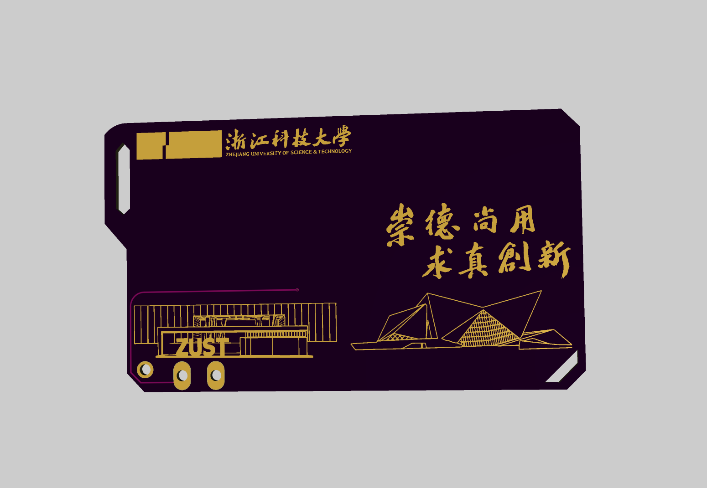
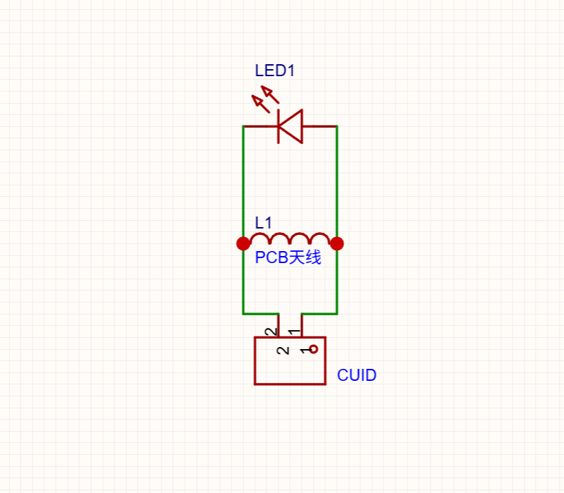
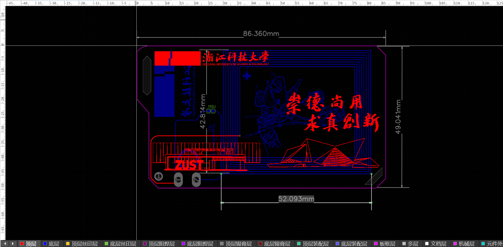
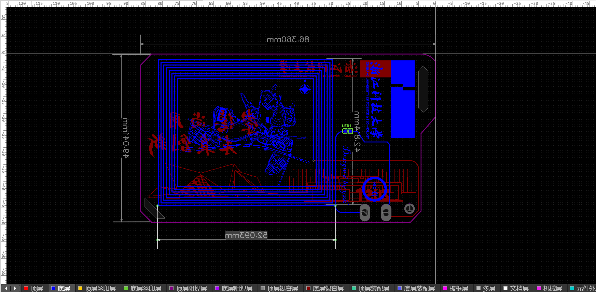
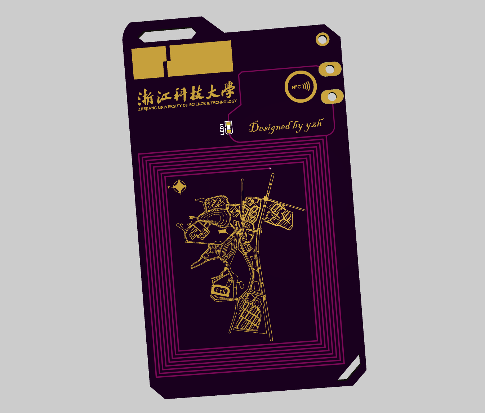
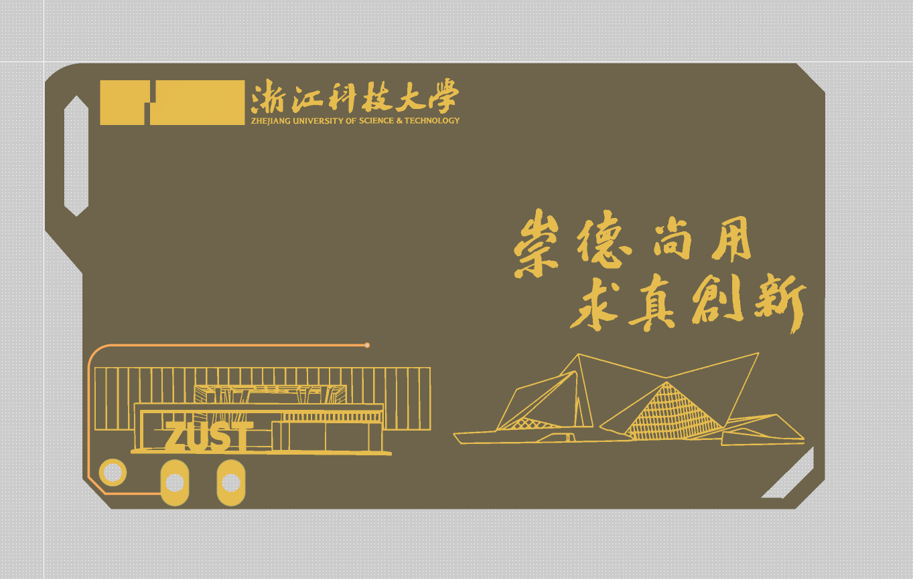
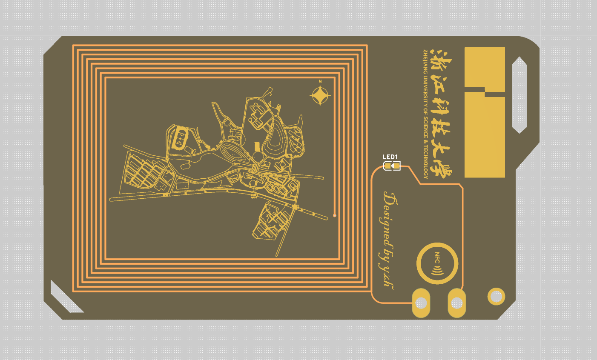
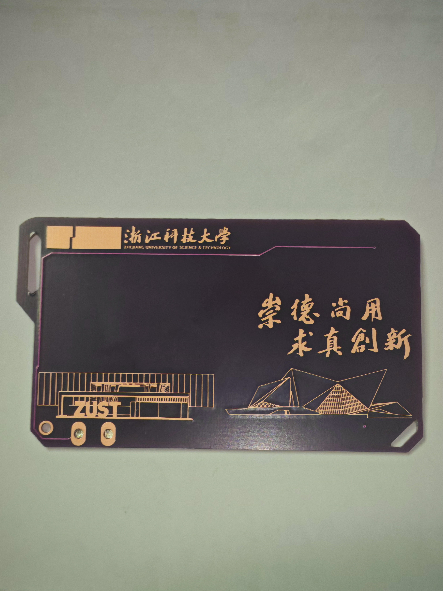
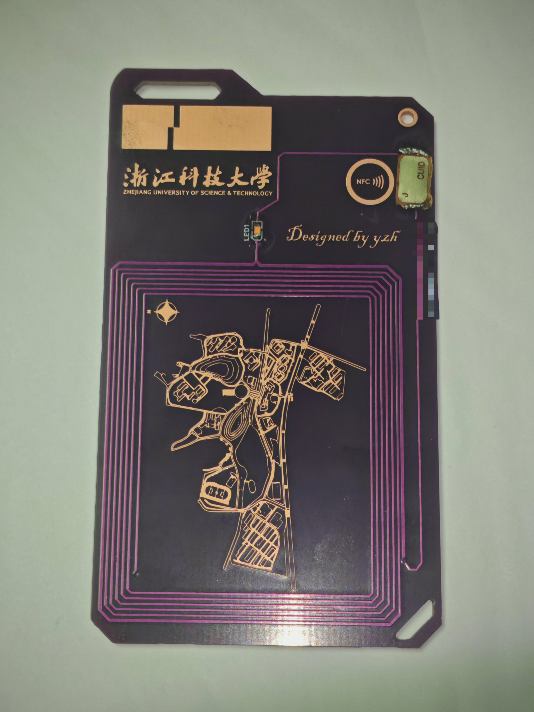

 

  
# 浙江科技大学 NFC校园卡

更适合浙科大宝宝体质的无源 NFC 校园卡😄。卡面结合校训与校园建筑线稿，电路由 PCB 天线、CUID 模块和感应LED指示灯组成。如有定制或代贴片需求可通过主页邮箱联系📫。

紫色方案正面。右侧为校训，下方为校园建筑轮廓，左上角设有挂绳槽。

  
## 电路

L1 表示 PCB 铜线绕成的天线。CUID 的两个端子接在线圈两端，LED1 并接在同一对端子上。LED 用于指示感应状态（主要是帅&装逼）。
NFC线圈电感大约为6.6μF。
## PCB 布局

| 正面 | 反面 |
| --- | --- |
|  |  |
| 查看板框、挂绳槽和正面图案的位置。 | 查看线圈沿卡面绕行的位置，以及中央图案与板边的布局。 |

## 外观预览

紫色方案反面。中央图案位于矩形线圈区域内，可与上方的反面布局图对照查看。
还可以自己换很多颜色，下面是铜色的预览👇（还有绿色、蓝色、白色、黄色、红色、黑色）
| 铜色正面 | 铜色反面 |
| --- | --- |
|  |  |
| 查看浅色背景下校训和建筑线稿的对比度。 | 查看中央线稿、外围线圈和侧边文字的排布。 |

以上外观图均为设计预览。以下是我打出来的自用成品👇。
| 实物正面（紫） | 反面(紫) |
| --- | --- |
|  |  |

## 打开工程与打样

- **编辑设计（不编辑直接打请跳过）**：下载并解压整个仓库，在嘉立创 EDA 专业版打开 `hardware/` 下的 `.eprj3` 工程。请保留同级的 `sch/` 和 `pcb/`，其中分别存放原理图和 PCB 源文件。
- **查看打板文件（直接打板看这里）**：`fabrication/` 下是 2026-11-18 导出的 Gerber ZIP。打样前在 Gerber 查看器中核对板框、铜层和丝印，并核对所购 CUID 模块的焊点与板上焊盘是否匹配。
- **验证样板**：可先装 CUID 测试读卡，再装 LED，用同一读卡器和方向复测读距。

## 作者与许可

作者原创的设计文件、图案和文档按 CC BY-NC-SA 4.0 分享。欢迎个人学习、打样和修改。再发布时请保留署名、附许可链接并标明修改，改版按相同方式共享。商业使用需另行授权。校名、校标及其他第三方素材的权利归各自权利人。详见[许可说明](https://creativecommons.org/licenses/by-nc-sa/4.0/deed.zh-hans)。

本版设计与整理：叶宗豪（Felix Ye）。[作者主页](https://1zonghao.github.io/personal-web)

如果您觉得还不错，可以随缘请我喝杯咖啡~

